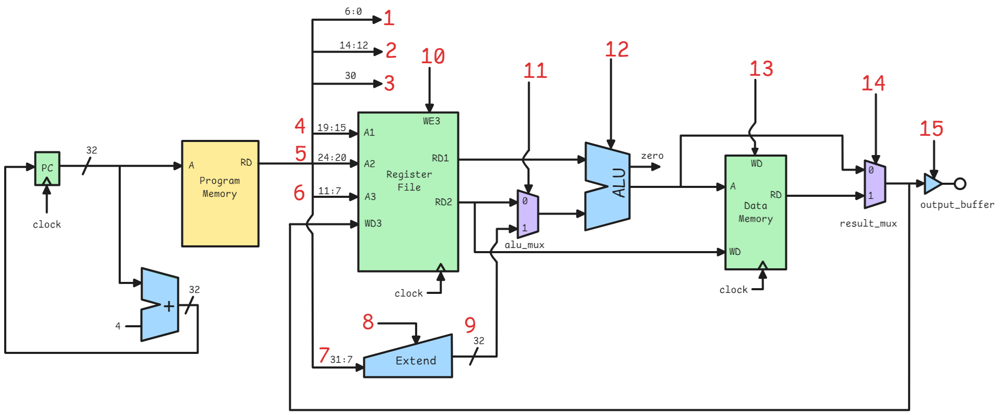

From the above figure and reading through the provided code for part 1, we can determine the names of the signals. 

| Number on Image | Signal Name | Description
| --- | --- | --- |
1 | `opcode` | Determines what type of instruction to do. (e.g. add, branch, load, store, etc.)
2 | `funct3` | A 3-bit extension to an opcode that specifies what specific instruction to do. For example, it can differentiate `XOR` from `OR` or `AND`.
3 | `funct7_bit` | Bit 30 of an instruction is the only section of the `funct7` section that differentiates between what type of instruction to do in a given instruction type. It differentiates, for example shift right logical (`SRL`) from shift right arithmetic (`SRA`).
4 | `rs1_addr` | "Register 1 Address". This is the index of the register for the first operand of an operation. 
5 | `rs2_addr` | "Register 2 Address". This is the index of the register for the second operand of an operation.
6 | `rd_addr`| "Destination Register Address". This is the index of the register to write the result of an operation to.
7 | `instr` | "Instruction" in code, but should be called "Immediate". This is the section of the instruction that holds an immediate value for U-type and J-type instructions. For U-type instructions. this is used for loading 20-bit values into a destination register. For J-type instructions, this specifies the 20-bit offset for large unconditional jump instructions.
8 | `imm_sel` | Zero-extends or sign-extends the incoming `imm` signal to 32 bits. If 20-bit immediates require sign-extension for J and U-type instructions (e.g. loading a negative value), `ext` could be all ones if necessary.
9 | `ext_imm` | The extended immediate value. 32 bits.
10 | `rd_we` | "Write enable". If high, this allows registers to be written to, if low, this disallows registers to be written to.
11 | `alu_sel` | This determines whether an immediate (`ext_imm`) or register 2 `rs2_data` is used as the second operand in the ALU.
12 | `alu_ctrl` | Determines what operation to do in the ALU (e.g. XOR, AND, etc.).
13 | `mem_we` | Data memory "Write enable". The bit that allows/disallows writes to data memory (1kB RAM w/ synchronous read/writes).
14 | `res_sel` | "Result select". Determines whether to select the output from data memory or the output of the ALU to be fed back to `rd_data` (Destination register's data) and output buffer.
15 | `out_en` | "Output Enable". If high, output buffer carries the signal from the result MUX to the output, else the output is floating/high impedance.
